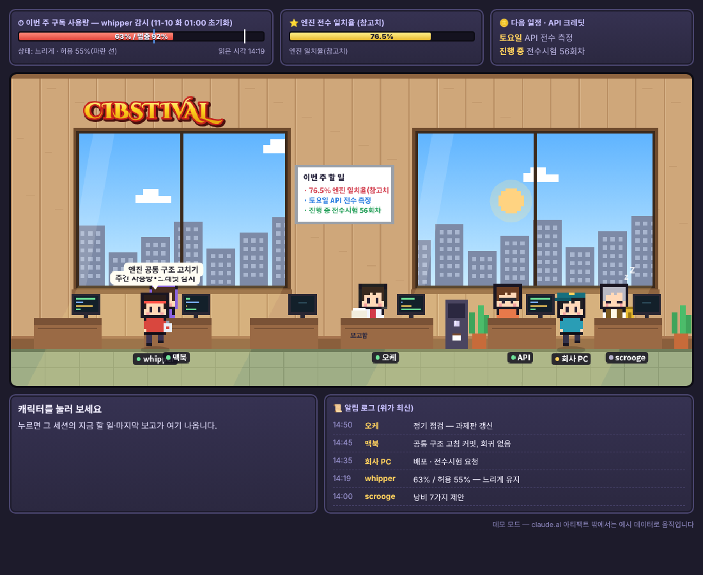

# CIBSTIVAL 가상 사무실

여러 Claude 작업 세션(총괄·개발·실행·API·감독·토큰 감시)이 일하는 모습을 도트 캐릭터 사무실로 보여 주는 한 장짜리 웹 페이지입니다.



## 바로 보기

`index.html`을 브라우저로 열면 됩니다. 설치할 것은 없습니다. claude.ai 아티팩트 밖에서는 **데모 모드**로 열리고, 페이지 안에 든 예시 데이터로 움직입니다.

## 어떻게 움직이나

- **페이지는 고정된 프로그램입니다.** 캔버스(960×440)에 도트 캐릭터, 책상, 창문을 그립니다.
  - 캐릭터 동작은 브라우저가 상태값을 보고 스스로 만드는 연출입니다. 일하는 중이면 타이핑하고 가끔 총괄에게 보고하러 걸어가고, 대기면 돌아다니고, 쉬면 졸고, 중지면 회색이 됩니다.
  - 창밖 하늘(해·노을·달·별)은 서울 시각을 따라 바뀝니다.
- **데이터는 작은 문서 하나(`office/state`)입니다.** claude.ai 아티팩트로 올리면 페이지가 아티팩트 데이터베이스(`claude.use("db")`)의 이 문서를 구독합니다.
  - 총괄 세션이 정기 점검 때마다 이 문서를 고쳐 쓰면, 열려 있는 화면이 새로고침 없이 바뀝니다.
  - 각 작업 세션이 페이지에 직접 데이터를 보내지는 않습니다. 세션은 보고 문서를 쓰고, 총괄이 그것을 읽어 상태를 정리해 넣습니다.
  - 그래서 실시간 중계가 아니라 점검 주기마다 바뀌는 상황판입니다.

## 데이터 형식 (`office/state`)

예시는 `sample-state.json`에 있습니다.

```
{
  updated: "11-06 14:50 (오케)",
  usage:   { pct, allowed, state, stop, at },        // 주간 사용량 HP바
  progress:{ items:[ {v, l}, ... ] },                // 첫 항목 = EXP바, 나머지 = 오른쪽 위 KPI
  sessions:[ { id: oke|mac|pc|api|whip|scrooge, name, status: working|waiting|idle|stopped,
               task, last, note, bubble?, reported? } ],
  feed:    [ { t, who, text } ]                      // 알림 로그(위가 최신)
}
```

## 만든 것·쓴 것

- 캐릭터·사무실은 이 페이지를 위해 새로 그린 도트 그림입니다. 어떤 게임의 그림도 가져오지 않았습니다.
- 간판 글꼴: **Cinzel Decorative**(Natanael Gama). SIL Open Font License 1.1이며 `index.html` 안에 들어 있습니다. 라이선스 전문은 `FONT-LICENSE-OFL.txt`에 있습니다.
- 그 밖의 글꼴: Noto Sans KR(Google Fonts에서 불러옴).
